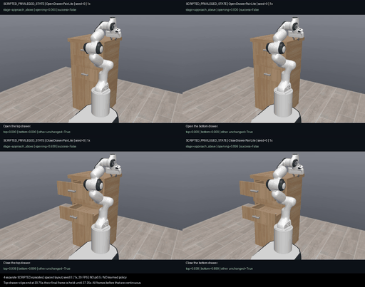
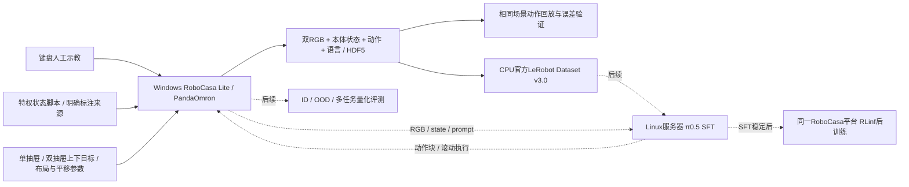

# Pi05-RoboCasa-Cabinet

基于 **MuJoCo + RoboCasa/robosuite + LeRobot + π0.5** 的语言指令柜体操作项目。机器人使用 **PandaOmron**，先完成 OpenDrawer / CloseDrawer 的键盘示教与模仿学习，再扩展指定目标抽屉和物品收纳。

> **开发中 / Work in progress**：当前提供仿真、示教、数据转换和脚本基线；π0.5训练与真实模型推理待实现。版本进展见 [开发记录](CHANGELOG.md)。

**当前状态（2026-11-19）：Windows原生单抽屉及双抽屉Lite场景已运行；宽间距双抽屉的上/下层开/关四条指令已跑通。新增固定划分数据pilot共12次脚本尝试，11次稳定成功，成功候选分为7条train和4条validation，5215帧官方LeRobot重读核对通过。另有1条完整人工失败尝试。尚未训练或评测π0.5；物品收纳与正式ID/OOD评测未完成。**

本项目的Lite场景继承RoboCasa任务、抽屉fixture与成功判据，使用自定义小布局及robosuite纹理；它不是完整RoboCasa benchmark。完整厨房初次reset缺少Sink025资产，尚未安装资产全集，不能据此判定Windows不支持。

## 演示与结果



[双抽屉四指令MP4](assets/demo/drawer_pair_scripted_pilot.mp4)：四条独立脚本轨迹的同步拼图，20FPS、1倍模拟速度；上层轨迹20.75秒结束后停留末帧，下层轨迹27.25秒结束。画面显示指令、两抽屉开度及非目标是否误动；并非四阶段连续任务。详见 [双抽屉场景、判据与复现](docs/MULTI_DRAWER.md)。


[开抽屉MP4：脚本基线](assets/demo/scripted_open.mp4) · [关抽屉MP4：脚本基线](assets/demo/scripted_close.mp4)

单抽屉MP4为20FPS、1倍模拟速度、未剪辑；GIF为对应轨迹降采样展示。角标 `SCRIPTED_PRIVILEGED_STATE` 表示用仿真把手位置进行闭环位姿控制；机械臂通过 `env.step(action)` 真实接触把手，不直接修改抽屉qpos。**这些视频不代表π0.5自主推理。** 后续人工示教回放标注TELEOP/REPLAY，真实模型视频必须标明PI05和checkpoint。

| 检查 | 条件 | 实测结果 |
|---|---|---|
| 开抽屉脚本pilot | OpenDrawerLite，seed0，415步 | 最终归一化开度0.9641；末10步成功；双指接触145步 |
| 关抽屉脚本pilot | CloseDrawerLite，seed0，415步 | 最终开度0.0000181；末10步成功；双指接触144步 |
| 开抽屉保存动作回放 | 同版本/同场景，415步 | 最大关节误差1.66×10⁻¹³rad；开度误差5.77×10⁻¹⁵ |
| 键盘UI录制检查 | AGENT_UI_CHECK，40步 | Enter/F8保存与复位；回放关节/开度误差0；任务未完成 |
| 官方LeRobot转换/加载 | 2条脚本轨迹，830帧 | 双RGB逐像素、状态、动作、语言、时间戳逐帧核对通过 |
| 人工OpenDrawer尝试 | KEYBOARD_TELEOP，seed0，1200步 | 完整保存；归一化开度0.22049，未达到0.95成功阈值；保留失败标签 |
| 人工轨迹回放/LeRobot读取 | 上述1200步，独立技术核验数据集 | 最大关节误差8.07×10⁻⁹rad；双RGB/状态/动作/语言/时间戳逐帧核对通过 |
| 双抽屉四指令脚本pilot | spaced布局，seed0；各1次，共1920步 | 4/4最终及末10步稳定成功；非目标最大偏移3.84×10⁻⁹ |
| 双抽屉回放/转换 | 上述四条轨迹，1920帧 | 四条回放通过；最大关节误差1.15×10⁻¹¹rad；LeRobot逐帧核对通过 |
| 初始状态与错误目标评分 | 相同seed/布局切换top、bottom指令 | 初始time/qpos/qvel、双RGB和XML完全一致；离线反目标评分0/4成功 |
| 紧凑双抽屉开发诊断 | compact布局，seed0；四指令各1次 | 3/4成功；下层关闭误碰上层，失败与原因保留 |
| 平移初始条件与撤离修复 | spaced，seed1，柜体平移(+4cm,-3cm) | 初测3/4；定位下层关好后被斜向撤离带开，水平后退修复后4/4；旧失败保留 |
| 修复后双条件开发集 | 两组初始条件×四指令，共8条/3840帧 | 8/8最终及稳定成功；8条回放、3840帧官方LeRobot逐帧核对通过；仅开发pilot |
| 固定划分新初始化质量pilot | seed101/102/201，四指令各一次，共12次 | 11/12最终及稳定成功；失败为seed102下层关闭撤离后重新带开，整条保留并拒选 |
| 成功SFT候选与动作块读取 | train 7条/3295帧；validation 4条/1920帧 | 全5215帧官方核对、55个动作块边界样本、CPU batch检查通过；候选仍待人工质量确认 |
| 本批12条动作回放 | 包含失败轨迹；同文件hash关联 | 最大关节误差4.82×10⁻⁴rad、双抽屉开度误差5.18×10⁻⁵，均在既有容差内；失败未被改标成功 |
| π0.5 / ID与OOD成功率 | 待后续 | 未完成，不填预期分数 |

原始数值见 [results](results)，双抽屉报告见 [修复后两条件pilot](results/pair_spaced_postfix_development_v1/report.json)、[平移条件修复前](results/pair_spaced_shifted_seed1_before_withdraw_fix/report.json) 与 [紧凑布局失败诊断](results/pair_compact_development_v1/report.json)。以上为开发pilot和流水线检查；不能把参与调试的seed、少量平移点或离线错误目标评分当作模型泛化和语言理解成绩。

新增的 [SFT数据准备报告](results/sft_data_readiness_v1.json) 保留全部12次尝试的分母、成功候选来源/hash、出生侧计数、回放与动作块检查。采集前固定train/validation及40组未执行测试条件；旧调试轨迹全部排除。本批仍缺少“机器人从柜体左侧出生时成功关闭下层抽屉”的训练样本，数据量也不足以支持模型质量结论。预留世界坐标平移测试不等于已经实现机器人相对位置OOD；详见 [固定划分、失败与复现命令](docs/DATA_READINESS.md)。

## 快速运行（当前机器）

Windows10、Ryzen7 4800H、GTX1650Ti 4GB、16GB RAM已能运行单环境仿真及采集。环境和缓存均在D盘，本地不训练π0.5。训练计划使用8×RTX3090 Linux服务器，当前GPU忙，尚未连接训练。

```powershell
Set-Location D:\Robotics\Pi05-RoboCasa-Cabinet
$sim = 'D:\Robotics\envs\pi05-sim-win\Scripts\python.exe'
$data = 'D:\Robotics\envs\pi05-data-cpu\Scripts\python.exe'

# 已有环境校验，不重新安装
powershell -NoProfile -ExecutionPolicy Bypass -File scripts\bootstrap_data.ps1 -VerifyOnly

# 场景/双相机/状态检查；零动作不代表任务成功
& $sim scripts\scene_smoke.py --task OpenDrawerLite

# 人工键盘示教：点击窗口，Enter开始，F8保存，Esc退出
& $sim scripts\teleop_record.py --task OpenDrawerLite
# 关抽屉改为 --task CloseDrawerLite

# 双抽屉：无需人工操作的一键四指令录制、回放、判据检查和LeRobot转换
# 输出目录必须不存在；复用已安装环境，不下载数据或模型
powershell -NoProfile -ExecutionPolicy Bypass -File scripts\run_pair_pilot.ps1 -OutputRoot outputs\NEW_PAIR_PILOT

# 从当前已采集12条原始轨迹重新筛选成功候选，输出须为新目录/文件
& $data scripts\prepare_sft_data.py build --plan configs\data_splits_v1.json `
    --raw-root outputs\data_readiness_v1 --output data\lerobot\NEW_SFT_SELECTION `
    --report results\NEW_SFT_READINESS.json
```

按键：W/S前后、A/D左右、R/F升降、J/L/I/K/U/O旋转、Tab开闭夹爪、P固定夹持姿态辅助、Space暂停/继续、F8保存、F9丢弃。默认1200步后暂停提醒，按Space延长并继续；`--max-steps 0`可取消限时。失焦暂停仿真。详见 [键盘采集与回放](docs/TELEOP.md)。采集的成功/失败标签来自环境判定，按保存键不会自动算成功。

每次保存时打印实际episode目录。将下列示例路径替换为该目录；输出目录须为新的名称：

```powershell
# 先验证一条完整人工示教，不直接扩大数据量
& $sim scripts\replay_episode.py data\raw\teleop\实际episode目录\episode.hdf5 --output outputs\NEW_REPLAY
& $data scripts\convert_lerobot.py data\raw\teleop\实际episode目录\episode.hdf5 --output data\lerobot\NEW_TELEOP_DATASET

# 复现脚本物理基线（始终标注SCRIPTED）
& $sim scripts\scripted_rollout.py --task OpenDrawerLite --seed 0 --output outputs\NEW_SCRIPTED_OPEN
```

首次安装、固定依赖与兼容根因见 [Windows安装说明](docs/INSTALL_WINDOWS.md)。安装脚本保护现有上游提交和dirty文件；本机仿真依赖是有意保留的子集，`pip check`存在上游声明的未装工具依赖。CPU数据环境的`pip check`通过。无需为已跑通的流程新建第二套仿真环境。

## 架构与目录



```text
src/pi05_cabinet/
  envs.py              # Lite场景、Windows资产路径适配
  scripted.py          # 真实接触的特权状态脚本基线
  recording.py         # 脚本/人工共用流式录制
  adapters.py          # 双RGB、9维state、7维OSC action契约
scripts/
  bootstrap_sim.ps1 / bootstrap_data.ps1
  mujoco_smoke.py / scene_smoke.py
  scripted_rollout.py / teleop_record.py
  replay_episode.py / convert_lerobot.py
  run_pair_pilot.ps1 / evaluate_drawer_pair.py
  prepare_sft_data.py   # 固定划分、成功候选与动作块读取检查
configs/               # 采集前冻结的seed、位置区域和代码hash
requirements/          # 独立仿真与CPU数据环境锁定文件
docs/                  # 安装、采集、数据约定、服务器/RL与MVP验收
results/               # 小型实测JSON；不提交大型轨迹
assets/demo/           # 明确标注来源的小GIF/MP4
data/ outputs/ work/ checkpoints/  # 本地生成，gitignore
```

## 后续验收

1. 已完成三组新初始化的质量检查和成功候选选择，训练/验证分开，55个动作块边界样本通过。先在训练条件定位左侧下层关闭撤离失败、补齐成功示教，再用新版本清单小批扩充；保持失败原始数据和来源标签，暂不下载公开示教。
2. 已加入双抽屉及上下目标指令、同初始状态核对和误操作判据。后续由真实模型在相同状态交换prompt做闭环对照，再扩展物品收纳；环境解析指令不能证明模型语言理解。
3. 服务器空闲后先核对软件/显存与官方π0.5 trainer/processor，再短训练、保存/恢复、动作块闭环。配置和模型未实测前，不提供伪装成可用的一键训练命令。
4. 按episode和互不重叠初始位置区域划分数据；每任务20次ID+20次OOD，600步/20Hz预算，报告成功数/总数和Wilson95%区间，区分Lite与完整厨房。
5. SFT与闭环稳定后才接RLinf；官方已有RoboCasa PPO先例，但模型实现、state/action和checkpoint仍须适配。当前不训练RL，详见 [服务器与RL兼容调查](docs/SERVER_AND_RL.md)。

不要求所有轨迹都由操作者手动采集。已有脚本能够自动完成单/双抽屉开合，可用于独立标注的辅助采集；人工数据用于操作验证、质量检查及纠正。脚本轨迹仍标为 `SCRIPTED_PRIVILEGED_STATE`，不能当作人工或π0.5结果；本批发现的失败与覆盖缺口需先处理，不直接扩大采集量。当前人工失败轨迹的LeRobot副本仅用于转换核验，未选入成功SFT候选集。

[MVP验收边界](docs/MVP_PLAN.md) · [数据与动作契约](docs/DATA_CONTRACT.md) · [归属与上游引用](docs/ATTRIBUTION.md)

## 开源与归属

本项目实现单/双抽屉Lite布局、目标指令绑定、非目标误操作判据、Windows适配、接触脚本、键盘交互、共用录制/回放、数据转换与验证；机器人、fixture、物理引擎、原始抽屉判据、LeRobot和π0.5归属对应上游。参考Pi05-Mujoco、Pi05-FR3-Gello的工程与数据/部署展示思路，没有复制其抓取入篮项目。

本仓库以公开的开发中项目持续更新，已有本地工作作为首个Git快照，后续按实际开发和验证时间提交。本人实现采用 [MIT许可证](LICENSE)，第三方代码和资产保持原许可，具体边界见 [上游引用与实现范围](docs/ATTRIBUTION.md)。GitHub登录由仓库所有者操作；数据、权重、环境、缓存和密钥不进Git。
