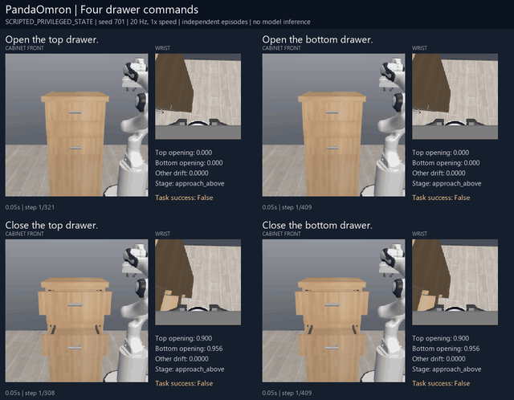
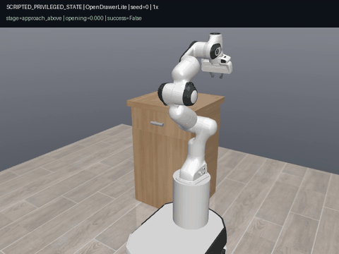
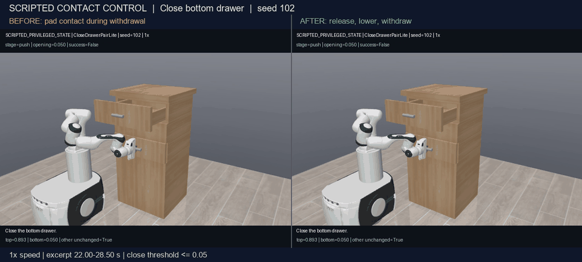
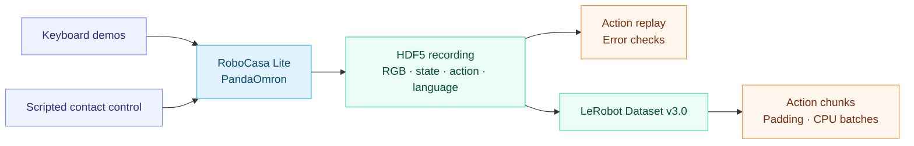
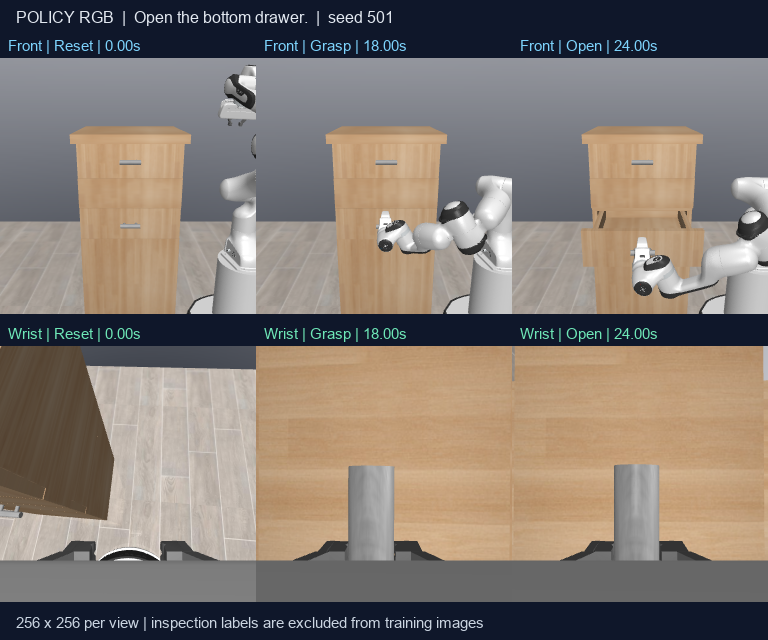

<p align="center">
  
</p>

<h1 align="center">Pi05-RoboCasa-Cabinet</h1>

<p align="center">
  <strong>Multi-task drawer manipulation with PandaOmron</strong><br>
  MuJoCo simulation · Multi-view demonstrations · LeRobot datasets for π0.5
</p>

<p align="center">
  <a href="requirements/sim-win.lock.txt"></a>
  <a href="requirements/sim-win.lock.txt"></a>
  <a href="docs/ATTRIBUTION.md"></a>
  <a href="requirements/data-cpu.lock.txt"></a>
  <a href="LICENSE"></a>
</p>

<p align="center">
  <a href="#demos">🎬 Demos</a> &nbsp;·&nbsp;
  <a href="#tasks">🗄️ Tasks</a> &nbsp;·&nbsp;
  <a href="#pipeline">🧭 Data pipeline</a> &nbsp;·&nbsp;
  <a href="#results">📊 Results</a> &nbsp;·&nbsp;
  <a href="#quickstart">🚀 Quickstart</a>
</p>

A **MuJoCo + RoboCasa/robosuite** workflow for drawer opening, closing, and language-specified target selection with **PandaOmron**. It brings together simulation, keyboard teleoperation, scripted contact control, episode recording, action replay, official LeRobot export, and HTTP action-chunk execution to prepare for π0.5 fine-tuning and deployment.

| 🗄️ Tasks | 📷 Observations | 🦾 Action interface | ⏱️ Control |
|---|---|---|---|
| 4 instructions, 2 target drawers | Cabinet-front + wrist RGB, 9D state | 7D normalized OSC command | 20 Hz |

<a id="demos"></a>

## 🎬 Demos

### Two drawers, four instructions

<p align="center">
  <a href="assets/demo/feedback_four_commands_v4.mp4">
    
  </a>
</p>

<p align="center">
  <strong>Pose and contact feedback · Recorded policy views · 20 FPS · 1× simulation speed</strong><br>
  <a href="assets/demo/feedback_four_commands_v4.mp4">▶ Watch MP4</a> &nbsp;·&nbsp;
  <a href="docs/DATA_READINESS_V4.md">Collection and replay checks</a> &nbsp;·&nbsp;
  <a href="results/collection_review_v4.json">Source hashes</a>
</p>

The four panes show opening the top drawer, opening the bottom drawer, closing the top drawer, and closing the bottom drawer on the first frozen training condition, seed 701. Each pane contains the actual cabinet-front and wrist RGB stored in its recording. Episodes run independently; shorter clips hold their final frame. Overlays show the instruction, stage, measured openings, and non-target movement. [Earlier overview-camera MP4](assets/demo/drawer_pair_scripted_pilot.mp4).

<details>
<summary><strong>▶ Single-drawer opening and closing</strong></summary>

<p align="center">
  
</p>

<p align="center">
  <a href="assets/demo/scripted_open.mp4">▶ Open drawer MP4</a> &nbsp;·&nbsp;
  <a href="assets/demo/scripted_close.mp4">▶ Close drawer MP4</a>
</p>

</details>

All clips use `SCRIPTED_PRIVILEGED_STATE`: the controller uses simulator handle poses to generate OSC actions, and the arm moves the drawers through physical contact. **These videos show scripted baselines, not π0.5 inference.**

<details>
<summary><strong>🔎 Contact diagnosis: releasing the lower handle</strong></summary>

<p align="center">
  <a href="assets/demo/withdraw_clearance_v2.mp4">
    
  </a>
</p>

The original closing trajectory reopened the drawer during retreat. Lowering the open gripper before withdrawing releases the loaded finger pad: final opening changes from **0.08134** to **0.03106**, against the same **0.05** threshold. Both panels share the same initialization and first 505 actions. The excerpt runs at 1× speed; the shorter left clip holds its final frame.

[▶ Comparison MP4](assets/demo/withdraw_clearance_v2.mp4) · [Contact measurements and reproduction](docs/CONTACT_CONTROL.md)

The optional [`feedback_v4` collector](docs/FEEDBACK_COLLECTOR.md) checks measured alignment and pad contact before advancing stages. Its 20 reused development trajectories and three failure re-recordings are documented separately from the fresh collection below.

</details>

<a id="tasks"></a>

## 🗄️ Tasks and capabilities

Single-drawer scenes use `OpenDrawerLite` / `CloseDrawerLite`; two-drawer scenes use `OpenDrawerPairLite` / `CloseDrawerPairLite`. Instructions are bound to the corresponding target fixture in the environment.

| Instruction | Target | Operation |
|---|---|---|
| `Open the top drawer.` | Top | Open |
| `Open the bottom drawer.` | Bottom | Open |
| `Close the top drawer.` | Top | Close |
| `Close the bottom drawer.` | Bottom | Close |

- **🗺️ Scene configuration** — RoboCasa drawer fixtures, configurable drawer spacing and cabinet translation, a fixed frontal camera covering both drawers, and paired-prompt checks on exact initial physics and measured RGB differences.
- **⌨️ Demonstration collection** — Keyboard translation, rotation, and gripper control; pause, save, discard, and optional fixed-orientation assistance.
- **🎥 Recording and replay** — Two RGB views, robot state, actions, language, initial simulator state, and scene XML; replay reports joint and drawer-opening errors.
- **📦 Dataset preparation** — Official LeRobot export and readback, frame-level checks, and action-chunk boundary and padding validation.
- **🎯 Task scoring** — Target opening, unintended movement of the other drawer, and stability over the final control steps.

The Lite scenes use a compact custom layout with upstream robot and drawer assets. Results refer to this layout. Full-kitchen asset requirements and Windows compatibility details are documented in the [installation guide](docs/INSTALL_WINDOWS.md).

<a id="pipeline"></a>

## 🧭 Data pipeline



| Policy field | Shape | Meaning |
|---|---|---|
| `observation.images.front` | `256 × 256 × 3` | Fixed cabinet-front RGB; legacy recordings retain the robot-left view |
| `observation.images.wrist` | `256 × 256 × 3` | Wrist-view RGB |
| `observation.state` | `9` | 7 arm joint positions + 2 finger positions |
| `action` | `7` | Normalized OSC translation, axis-angle delta, and gripper command |
| `task` | String | Language instruction |

Raw HDF5 stores **T actions and T+1 observations**; each training sample pairs an action with its preceding observation. Handle poses, drawer openings, and success labels are reserved for scripted control and scoring, and are excluded from policy inputs.

<p align="center">
  
</p>

Actual policy RGB from one recorded opening trajectory. Inspection labels appear only in this figure. The new `cabinet_front` profile keeps both drawers in view; raw recordings declare their camera profile, and the converter rejects mixed front-camera profiles. [Camera checks](results/camera_framing_v3.json) · [Image provenance](results/policy_views_v3_provenance.json).

Episodes are split by initialization condition, with separate training and validation datasets. Both use training-set normalization statistics. See the [data contract](docs/DATA_CONTRACT.md) and [split and collection guide](docs/DATA_READINESS.md).

<a id="results"></a>

## 📊 Results

### Feedback-gated collection (v4)

Four fresh initializations, seeds **701 / 702 / 703 / 801**, each run all four instructions with the frozen `feedback_v4` controller. Counts cover all attempts in this small scripted collection.

| Task | Stable successes / attempts |
|---|---:|
| Open top drawer | 4 / 4 |
| Open bottom drawer | 4 / 4 |
| Close top drawer | 4 / 4 |
| Close bottom drawer | 4 / 4 |
| **Total** | **16 / 16** |

| Data check | Recorded result |
|---|---|
| Training candidates | **12 episodes · 4,379 frames**, all four commands on both robot spawn sides |
| Validation candidates | **4 episodes · 1,465 frames**, one left-side initialization |
| Official LeRobot readback | **5,844 frames** checked against both raw RGB views, state, action, language, and timestamp |
| Completed feedback stages / action replays | **16 / 16** each; longest trajectory **425 / 600** actions |
| Maximum replay error | Joint `8.12 × 10⁻¹¹ rad` · drawer opening `4.75 × 10⁻¹⁰` |
| Action-chunk boundaries | **80 samples**, horizon **50**, same-episode padding |
| CPU batch | Action `[4, 50, 7]` · state `[4, 9]` · RGB `[4, 3, 256, 256]` per view |

Success requires target opening **≥ 0.95** for opening or **≤ 0.05** for closing, cumulative non-target drift **≤ 0.05**, and success over the **final 10 steps**. The control budget is **600 actions at 20 Hz**. Selection also requires every feedback stage to complete.

All eight prompt pairs have exactly equal initial physics and XML. Training RGB is bit-identical; both validation pairs differ at the same three frontal pixels by one uint8 level. The strict failure is retained, and a separate audit uses the previously fixed `lsb_v1` image profile. Exported RGB still matches its raw source pixel-for-pixel. [Reset measurements](results/rgb_reset_difference_v4.json).

These are successful demonstration candidates. Full-episode human visual acceptance and broader initialization coverage are still needed for SFT. The 40 reserved test conditions remain unexecuted. π0.5 training and learned-policy evaluation have not been run. [Protocol and commands](docs/DATA_READINESS_V4.md) · [Full data report](results/sft_data_readiness_v4.json) · [Review media provenance](results/collection_review_v4.json).

<details>
<summary><strong>Earlier cabinet-front collection (v3)</strong></summary>

### Cabinet-front collection (v3)

Four fresh initializations, seeds **501 / 502 / 503 / 601**, each run all four instructions. The controller and collection files were frozen before recording. Success counts include failed attempts; these are scripted collection results.

| Task | Stable successes / attempts |
|---|---:|
| Open top drawer | 3 / 4 |
| Open bottom drawer | 3 / 4 |
| Close top drawer | 4 / 4 |
| Close bottom drawer | 3 / 4 |
| **Total** | **13 / 16** |

| Data check | Recorded result |
|---|---|
| Training candidates | **9 episodes · 4,305 frames**, all four commands represented on each robot spawn side |
| Validation candidates | **4 episodes · 1,945 frames** |
| Official LeRobot readback | **6,250 frames** checked against source RGB, state, action, language, and timestamp |
| Action replays | **16 / 16** passed, including the three failed task episodes |
| Maximum replay error | Joint `8.45 × 10⁻⁴ rad` · drawer opening `1.12 × 10⁻⁴` |
| Action-chunk boundaries | **65 samples**, horizon **50**, same-episode padding |
| CPU batch | Action `[4, 50, 7]` · state `[4, 9]` · RGB `[4, 3, 256, 256]` per view |

Seed 502 failed to open and close the lower drawer; seed 503 failed to open the upper drawer. Full failures remain in raw storage and are excluded from successful candidates. Contact replay found a missed pad grasp for lower opening and residual lower-pad contact during closing retreat. The nominal clearance waypoint therefore does not cover every initialization. [Failure measurements](results/data_readiness_failure_stages_v3.json) · [Seed 502 contacts](results/contact_failures_seed502_v3.json).

Paired prompts have identical initial physics and XML. One closing pair differed in three RGB pixels by one uint8 level; a separately recorded image QA profile accepts this bounded difference. Raw-to-LeRobot image readback still requires exact pixels. [Image QA protocol](configs/rgb_reset_audit_v1.json) · [Collection and reproduction](docs/DATA_READINESS_V3.md) · [Full report](results/sft_data_readiness_v3.json).

Candidates require full-episode human visual acceptance before training. The validation set has one initialization on the right spawn side. The 40 reserved test conditions remain unexecuted; these measurements establish neither learned language following nor policy generalization.

</details>

<details>
<summary><strong>Earlier collection and development regression</strong></summary>

### Original collection (v1)

Three initializations, seeds **101 / 102 / 201**, each run all four instructions in the `spaced` layout. Counts include every attempt.

| Task | Stable successes / attempts |
|---|---:|
| Open top drawer | 3 / 3 |
| Open bottom drawer | 3 / 3 |
| Close top drawer | 3 / 3 |
| Close bottom drawer | 2 / 3 |
| **Total** | **11 / 12** |

Success requires a normalized opening **≥ 0.95** for opening or **≤ 0.05** for closing, non-target opening drift **≤ 0.05** throughout the episode, and success over the **final 10 steps**. Runs use **20 Hz** control and a **600-step** budget.

In seed 102, the bottom drawer reopened during retreat. The complete failed episode and replay are retained and excluded from successful demonstration candidates. See the [original failure report](results/data_readiness_failure_train002_close_bottom.json).

### Contact clearance regression

Contact replay identified loaded lower-finger contact after release. The revised controller lowers the open gripper waypoint by 25 mm before withdrawing. All four instructions were rerun on seeds **101 / 102**, covering both robot spawn sides:

| Check | Clearance revision |
|---|---:|
| Stable task successes / attempts | **8 / 8** |
| Recorded action replays passed | **8 / 8** |
| Paired-prompt reset checks | **4 / 4** |
| Maximum trajectory length | **570 / 600 steps** |
| Seed 102 lower closing, final opening | **0.03106** |

These are development regression conditions. [Contact diagnosis](docs/CONTACT_CONTROL.md) and the [regression report](results/withdraw_regression_v2.json) retain the same success thresholds and source hashes; these runs are excluded from the new collection split.

### Original dataset and replay checks (v1)

| Check | Recorded result |
|---|---|
| Training candidates | **7 episodes · 3,295 frames** |
| Validation candidates | **4 episodes · 1,920 frames** |
| Official LeRobot readback | **5,215 frames** checked: both RGB views, state, action, language, and timestamp |
| Action replay | **12 / 12** passed, including the failed task episode |
| Maximum joint replay error | `4.82 × 10⁻⁴ rad` |
| Maximum drawer-opening replay error | `5.18 × 10⁻⁵` |
| Action-chunk boundaries | **55 samples**, chunk length **50**, no cross-episode padding |
| CPU batch shapes | Action `[4, 50, 7]` · state `[4, 9]` · each RGB view `[4, 3, 256, 256]` |

The [experiment report](results/sft_data_readiness_v1.json) records provenance, file hashes, and raw statistics. These are scripted collection and data-pipeline results. π0.5 training and learned-policy rollouts have not been run; the [training and evaluation guide](docs/SERVER_AND_RL.md) describes the integration requirements.

</details>

π0.5 training and model rollouts have not been run. The [server integration guide](docs/SERVER_AND_RL.md) specifies processor, checkpoint, and closed-loop checks for the next stage.

<a id="quickstart"></a>

## 🚀 Quickstart

**Verified stack:** Windows 10 · Python 3.11 · MuJoCo 3.3.1 · RoboCasa 1.0.1 · robosuite 1.5.2. Dataset tools use LeRobot 0.4.4 and PyTorch 2.7.1+cpu in a separate environment.

### 1. Install

Prerequisites: Git, 64-bit Python 3.11, and the MSVC runtime. Run in PowerShell:

```powershell
git clone https://github.com/Turbo176/Pi05-RoboCasa-Cabinet.git
Set-Location Pi05-RoboCasa-Cabinet

$python311 = (& py -3.11 -c "import sys; print(sys.executable)").Trim()
powershell -NoProfile -ExecutionPolicy Bypass -File scripts\bootstrap_sim.ps1 -BasePython $python311
powershell -NoProfile -ExecutionPolicy Bypass -File scripts\bootstrap_data.ps1 -BasePython $python311
```

Environments are created under `envs/` in the parent directory. Use `-VerifyOnly` with an existing installation. Pinned dependencies and compatibility notes are in the [Windows setup guide](docs/INSTALL_WINDOWS.md).

### 2. Open a scene and collect demonstrations

```powershell
$roboticsRoot = Split-Path -Parent (Get-Location).Path
$sim = Join-Path $roboticsRoot 'envs\pi05-sim-win\Scripts\python.exe'
$data = Join-Path $roboticsRoot 'envs\pi05-data-cpu\Scripts\python.exe'

# Check the scene, both cameras, and robot state
& $sim scripts\scene_smoke.py --task OpenDrawerLite

# Click the window, then press Enter to start
& $sim scripts\teleop_record.py --task OpenDrawerLite
```

| Input | Control | Input | Control |
|---|---|---|---|
| `W / S`, `A / D`, `R / F` | Translate | `J / L`, `I / K`, `U / O` | Rotate |
| `Tab` | Toggle gripper | `P` | Fixed-orientation assistance |
| `Space` | Pause / resume / extend | `F8 / F9` | Save / discard |
| `Enter` | Start recording | `Esc` | Exit |

The recorder pauses every 1,200 steps; `Space` extends the recording. See the [teleoperation guide](docs/TELEOP.md) for replay and conversion commands.

### 3. Run all four scripted tasks

```powershell
# Collect, replay, score, and convert four scripted episodes
powershell -NoProfile -ExecutionPolicy Bypass -File scripts\run_pair_pilot.ps1 `
    -OutputRoot outputs\drawer_pair_run01 -SimPython $sim -DataPython $data
```

Use a new output directory for each run. Outputs include trajectories, replay videos, scoring reports, and LeRobot data, with outcome and controller-source labels preserved.

Local hardware handles simulation, collection, replay, and video recording. Model training and inference are assigned to a Linux GPU server. Datasets, weights, and environments are excluded from Git.

### 4. Check HTTP action-chunk execution

```powershell
& $sim scripts\check_remote_chunks.py `
    --condition outputs\data_readiness_v4\train_001 `
    --output outputs\NEW_REMOTE_CHUNK_CHECK
```

The check sends language, both RGB views and robot state through a loopback HTTP endpoint. Each response contains 50 actions; MuJoCo executes the first five before sending a fresh observation. Four recorded tasks passed **1,447 actions / 291 requests**. Stale-episode and timeout checks both stopped after five valid actions, with no further action or simulator-time advance while waiting.

The endpoint returns **recorded scripted actions**, labeled `RECORDED_ACTION_CHUNKS`. This verifies transport and execution; π0.5 inference still requires a model server and processor checks. [Protocol, results and separate server/client commands](docs/REMOTE_INFERENCE.md).

<a id="layout"></a>

## 📂 Project layout

<details>
<summary><strong>Browse the repository structure</strong></summary>

```text
src/pi05_cabinet/
  envs.py               # Lite scenes, target instructions, Windows asset paths
  scripted.py           # Physical-contact drawer controller
  recording.py          # Streaming HDF5 and MP4 recording
  adapters.py           # Two RGB views, 9D state, 7D action
  inference.py          # Versioned HTTP action chunks and response validation
scripts/
  bootstrap_*.ps1       # Environment setup and verification
  teleop_record.py      # Keyboard demonstrations
  scripted_rollout.py   # Scripted collection
  replay_episode.py     # Action replay and error checks
  convert_lerobot.py    # Official export and frame-level verification
  evaluate_drawer_pair.py / run_pair_pilot.ps1
  prepare_sft_data.py   # Splits, selection, action-chunk checks
  make_collection_review.py # Full recorded policy-view videos and keyframes
  serve_action_replay.py / remote_policy_rollout.py
  check_remote_chunks.py # Four-task transport and fail-stop regression
configs/                # Initialization conditions, splits, frozen code hashes
requirements/           # Simulation and CPU dataset dependencies
docs/                   # Setup, collection, data, and model integration
results/                # Experiment reports
assets/demo/            # Videos and GIFs
assets/readme/          # Project icon and self-hosted badges
```

</details>

<a id="references"></a>

## 📚 Dependencies and license

This repository implements the Lite layouts, target-instruction binding, non-target movement checks, Windows compatibility layer, contact controller, and recording / replay / dataset verification tools.

Simulation uses **MuJoCo**, with the robot, drawer fixtures, and textures supplied by **RoboCasa and robosuite**. Dataset tooling uses **LeRobot**. The π0.5 base model is provided by **Physical Intelligence**.

[📖 Attribution and pinned upstream versions](docs/ATTRIBUTION.md) &nbsp;·&nbsp; [📝 Changelog](CHANGELOG.md) &nbsp;·&nbsp; [⚖️ MIT License](LICENSE)

New code in this repository is MIT-licensed. Third-party code and assets retain their original licenses.
