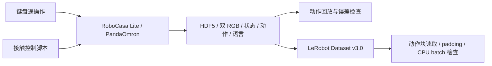

# Pi05-RoboCasa-Cabinet

**PandaOmron 柜体操作 · 双视角示教采集 · LeRobot 数据管线**

面向 π0.5 微调的机器人柜体操作项目，使用 MuJoCo、RoboCasa/robosuite 和 PandaOmron。项目围绕抽屉开合与语言指定目标抽屉，提供场景配置、键盘遥操作、接触控制脚本、轨迹录制、动作回放和 LeRobot 数据转换。

主要实现包括单/双抽屉 Lite 场景、四条目标指令、前视与腕部 RGB 采集、9 维机器人状态与 7 维 OSC 动作适配，以及按初始化条件划分的数据检查流程。

## 演示

### 双抽屉四指令


[查看 MP4](assets/demo/drawer_pair_scripted_pilot.mp4) · [场景与控制说明](docs/MULTI_DRAWER.md)

四个画面分别对应上层打开、下层打开、上层关闭和下层关闭。视频由四条独立轨迹拼接，按 20 FPS、1 倍模拟速度播放，画面显示目标指令、两层抽屉开度和非目标抽屉变化。

### 单抽屉开合


[打开抽屉 MP4](assets/demo/scripted_open.mp4) · [关闭抽屉 MP4](assets/demo/scripted_close.mp4)

以上演示使用 `SCRIPTED_PRIVILEGED_STATE` 控制器：根据仿真中的把手位姿生成 OSC 动作，由机械臂通过接触拉开或推回抽屉。视频来源为脚本控制，未使用 π0.5 模型推理。

## 任务与实现

单抽屉任务使用 `OpenDrawerLite` / `CloseDrawerLite`；双抽屉任务使用 `OpenDrawerPairLite` / `CloseDrawerPairLite`，通过语言指令指定目标。

| 指令 | 目标操作 |
|---|---|
| `Open the top drawer.` | 打开上层抽屉 |
| `Open the bottom drawer.` | 打开下层抽屉 |
| `Close the top drawer.` | 关闭上层抽屉 |
| `Close the bottom drawer.` | 关闭下层抽屉 |

- **场景与控制**：复用 RoboCasa 的 Drawer fixture 和任务初始化，支持上下目标、抽屉间距及柜体平移配置。同一初始条件下切换目标指令，保持物理状态与相机画面一致。
- **示教采集**：键盘控制末端平移、旋转和夹爪，支持暂停、保存、丢弃及固定夹持姿态辅助；人工与脚本轨迹分别记录来源。
- **录制与回放**：保存双 RGB、机器人状态、动作、语言、初始仿真状态及场景 XML，重新执行动作并报告关节与抽屉开度误差。
- **数据处理**：使用官方 LeRobot Dataset API 转换与加载，逐帧核对图像、状态、动作、语言和时间戳，检查动作块边界与 padding。
- **成功判定**：同时检查目标抽屉开度、非目标抽屉误动和末段稳定性。

Lite 场景采用自定义小布局，复用官方机器人与抽屉资产。本文实验针对该布局；完整 RoboCasa 厨房的安装差异见 [Windows 安装说明](docs/INSTALL_WINDOWS.md)。

## 数据流程



| 策略字段 | 形状 | 内容 |
|---|---|---|
| `observation.images.front` | `256 × 256 × 3` | 前视 RGB |
| `observation.images.wrist` | `256 × 256 × 3` | 腕部 RGB |
| `observation.state` | `9` | 7 个机械臂关节位置 + 2 个夹指位置 |
| `action` | `7` | OSC 归一化末端位移、轴角增量与夹爪控制 |
| `task` | 字符串 | 语言任务指令 |

原始 HDF5 保存 T 个动作和 T+1 个观测；转换时以动作前的观测构造监督样本。把手位姿、抽屉开度和成功标记用于脚本控制与评测，不进入策略输入。

数据按 episode 和初始化条件划分，训练与验证分别保存；归一化使用训练集统计量。数据格式、坐标系和来源标签见 [数据约定](docs/DATA_CONTRACT.md)，固定划分与采集命令见 [数据准备](docs/DATA_READINESS.md)。

## 实验结果

### 脚本采集

在 `spaced` 双抽屉布局上，使用 seed 101、102、201 三组初始化，每组执行四条指令。下表统计脚本采集的完整尝试。

| 任务 | 稳定成功 / 尝试数 |
|---|---|
| 打开上层抽屉 | 3 / 3 |
| 打开下层抽屉 | 3 / 3 |
| 关闭上层抽屉 | 3 / 3 |
| 关闭下层抽屉 | 2 / 3 |
| **合计** | **11 / 12** |

成功要求：打开时归一化开度 ≥ 0.95，关闭时 ≤ 0.05；全轨迹非目标抽屉累计开度偏移 ≤ 0.05，且末 10 个控制步持续满足目标条件。控制频率为 20 Hz，单次任务预算为 600 步。

seed 102 的下层关闭在撤离时重新带开，原始轨迹及回放保留，未选入成功示教候选。详见 [失败分析](results/data_readiness_failure_train002_close_bottom.json)。

### 数据与回放检查

| 项目 | 结果 |
|---|---|
| 训练候选 | 7 条，3295 帧 |
| 验证候选 | 4 条，1920 帧 |
| 官方 LeRobot 逐帧核对 | 5215 帧通过，覆盖双 RGB、状态、动作、语言和时间戳 |
| 原始轨迹动作回放 | 12 / 12 通过，包含失败轨迹 |
| 最大关节回放误差 | 4.82 × 10⁻⁴ rad |
| 最大抽屉开度回放误差 | 5.18 × 10⁻⁵ |
| 动作块边界检查 | 55 个样本通过，块长 50，padding 不跨 episode |
| CPU batch | 动作 `[4, 50, 7]`，状态 `[4, 9]`，每路 RGB `[4, 3, 256, 256]` |

原始统计、轨迹来源与文件哈希见 [实验报告](results/sft_data_readiness_v1.json)。这些结果衡量脚本采集和数据链路；π0.5 训练与模型闭环验证尚未执行，接入约定见 [训练与评测说明](docs/SERVER_AND_RL.md)。

## 快速运行

已验证环境：Windows 10、Python 3.11、MuJoCo 3.3.1、RoboCasa 1.0.1、robosuite 1.5.2；数据工具使用 LeRobot 0.4.4 和 CPU PyTorch 2.7.1。仿真与数据处理分别安装在独立环境中。

在 PowerShell 中克隆并安装，需预先安装 Git、64 位 Python 3.11 和 MSVC 运行库：

```powershell
git clone https://github.com/Turbo176/Pi05-RoboCasa-Cabinet.git
Set-Location Pi05-RoboCasa-Cabinet

$python311 = (& py -3.11 -c "import sys; print(sys.executable)").Trim()
powershell -NoProfile -ExecutionPolicy Bypass -File scripts\bootstrap_sim.ps1 -BasePython $python311
powershell -NoProfile -ExecutionPolicy Bypass -File scripts\bootstrap_data.ps1 -BasePython $python311
```

安装脚本将环境放在项目上一级目录的 `envs/` 下。已有环境可使用 `-VerifyOnly` 检查；固定依赖、上游提交及兼容问题见 [安装说明](docs/INSTALL_WINDOWS.md)。

```powershell
$roboticsRoot = Split-Path -Parent (Get-Location).Path
$sim = Join-Path $roboticsRoot 'envs\pi05-sim-win\Scripts\python.exe'
$data = Join-Path $roboticsRoot 'envs\pi05-data-cpu\Scripts\python.exe'

# 检查场景、双相机和机器人状态
& $sim scripts\scene_smoke.py --task OpenDrawerLite

# 键盘遥操作：点击窗口，Enter 开始，F8 保存，Esc 退出
& $sim scripts\teleop_record.py --task OpenDrawerLite

# 四指令脚本采集、动作回放、成功判定与 LeRobot 转换
powershell -NoProfile -ExecutionPolicy Bypass -File scripts\run_pair_pilot.ps1 `
    -OutputRoot outputs\drawer_pair_run01 -SimPython $sim -DataPython $data
```

`OutputRoot` 必须为新目录。四指令命令输出轨迹、回放视频、评测报告及 LeRobot 数据；转换保留每条轨迹的成功标签和脚本来源。

键盘操作：W/S 前后，A/D 左右，R/F 升降，J/L/I/K/U/O 旋转，Tab 开闭夹爪，P 固定夹持姿态，Space 暂停/继续，F8 保存，F9 丢弃。默认每 1200 步暂停，Space 可延长；完整采集、回放和转换命令见 [遥操作说明](docs/TELEOP.md)。

本地负责仿真、数据采集、回放与视频录制，模型训练和推理使用 Linux GPU 服务器。数据、权重与环境不随仓库分发。

## 项目结构

```text
src/pi05_cabinet/
  envs.py              # Lite 场景、目标指令与 Windows 资产路径适配
  scripted.py          # 通过物理接触开合抽屉的脚本控制器
  recording.py         # HDF5 / MP4 流式录制
  adapters.py          # 双 RGB、9 维状态与 7 维动作适配
scripts/
  bootstrap_*.ps1      # 环境安装与验证
  teleop_record.py     # 键盘示教
  scripted_rollout.py  # 脚本轨迹采集
  replay_episode.py   # 动作回放与误差检查
  convert_lerobot.py  # 官方 LeRobot 转换与逐帧核对
  evaluate_drawer_pair.py / run_pair_pilot.ps1
  prepare_sft_data.py  # 数据划分、成功轨迹筛选与动作块检查
configs/               # 固定初始化条件、数据划分与代码哈希
requirements/          # 仿真与 CPU 数据环境依赖
docs/                  # 安装、数据格式、采集与模型接入说明
results/               # 实验报告
assets/demo/           # 演示视频与 GIF
```

## 参考与许可

本项目实现 Lite 场景布局、目标指令绑定、非目标误操作判据、Windows 适配、接触控制脚本，以及采集、回放和数据验证流程。物理引擎、机器人、fixture、纹理、数据 API 和基础模型分别来自 MuJoCo、RoboCasa、robosuite、LeRobot 与 Physical Intelligence。

工程组织、采集与部署流程、视频展示方式参考 [Pi05-Mujoco](https://github.com/metro8116/Pi05-Mujoco) 和 [Pi05-FR3-Gello](https://github.com/metro8116/Pi05-FR3-Gello)。详细版本与实现归属见 [上游引用](docs/ATTRIBUTION.md)。

本项目新增代码采用 [MIT License](LICENSE)，第三方代码及资产保留各自许可。版本记录见 [CHANGELOG](CHANGELOG.md)。
