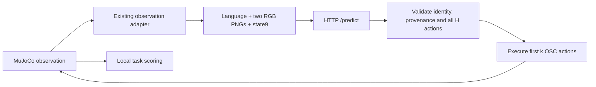

# HTTP action chunks

The client sends language, cabinet-front RGB, wrist RGB and nine robot joint /
finger positions to an HTTP endpoint. It validates a full action chunk, executes
its first five actions, then captures another observation. The current check
endpoint returns recorded actions. It does not run pi0.5 or choose actions from
the received images.

## Run the transport check

Use the existing simulation environment and a completed four-command collection.
The recordings are local data, excluded from Git; the
[collection guide](DATA_READINESS_V4.md) describes how to reproduce them.

```powershell
$sim = 'D:\Robotics\envs\pi05-sim-win\Scripts\python.exe'
& $sim scripts\check_remote_chunks.py `
    --condition outputs\data_readiness_v4\train_001 `
    --output outputs\NEW_REMOTE_CHUNK_CHECK
```

The command starts a loopback endpoint for each recording, runs MuJoCo in a
separate process, and checks two injected failures. It closes its child servers
afterward. Output directories must be new. Add `--no-video` to skip MP4 encoding.
No environment installation, model download or dataset download occurs.

Each check saves the endpoint log, client log, decoded-input shapes, request
identities, input hashes, latency, execution count and simulator-time checks.
Successful runs also save an MP4 unless disabled. A failed run retains its
reports and exits with a nonzero status.

## Measured check

The recorded source is v4 `train_001`, seed 701. Reusing this development
condition tests the execution interface; it adds no demonstrations or independent
policy-evaluation episodes. All four recordings originated from
`SCRIPTED_PRIVILEGED_STATE`. The reserved test conditions were not executed.

| Recorded command | Actions executed | HTTP requests | Stable final success | Maximum joint error, rad |
|---|---:|---:|---|---:|
| Open top | 321 | 65 | Yes | 2.47e-6 |
| Open bottom | 409 | 82 | Yes | 8.77e-6 |
| Close top | 308 | 62 | Yes | 6.52e-6 |
| Close bottom | 409 | 82 | Yes | 7.50e-6 |

All **1,447 actions / 291 requests** passed. Every endpoint request decoded a
`[9]` state and two `[256,256,3]` RGB images. Each response contained 50 actions;
the client executed at most five and discarded the unused tail. The final chunk
was limited to the remaining recorded actions. Last-action padding stayed within
the same recording. The adapter transports float32 actions; measured drawer
replay error was at most **2.44e-6**, within the existing 0.01 replay tolerance.

Both injected failures occurred on the second request, after five valid actions:

| Injected response | Client outcome | Actions after rejection | Simulator time advanced while waiting |
|---|---|---:|---:|
| Previous episode ID | Rejected; nonzero exit | 0 | 0 s |
| Two-second delay, 0.5-second client timeout | Rejected; nonzero exit | 0 | 0 s |

The protocol tests also cover stale request IDs and steps, checkpoint and schema
mismatches, malformed/non-finite/out-of-range actions, image round trips,
unexpected observation fields, invalid JSON, server errors, oversized responses
and replay/model provenance mismatches. All 12 tests passed in both existing
Python environments:

```powershell
& $sim -m unittest discover -s tests -v
& 'D:\Robotics\envs\pi05-data-cpu\Scripts\python.exe' -m unittest discover -s tests -v
```

[Full results and source hashes](../results/remote_action_chunks_v1.json).
Loopback latency includes local transport, PNG decoding and recorded-action
lookup. It does not measure model inference or a remote network.

## Protocol



`cabinet_action_chunk_v1` uses `pandaomron_arm_osc_v1`, the cabinet-front camera,
top-left RGB and 20 Hz control. JSON carries lossless base64 PNG images. The
model-side processor must receive these images without a second vertical flip.
The request has no drawer fractions, target handle coordinates, success labels
or simulator state.

Each response must match the protocol, observation schema, episode ID, unique
request ID, control step, checkpoint ID, camera, horizon, execution count,
control frequency and language/observation digest. The complete `[H,7]` action
array must be finite and within `[-1,1]`; an invalid unused tail also rejects the
whole response. The existing adapter adds stationary base/torso commands and arm
mode `-1` to produce the robot's 12D action.

Requests are synchronous. Simulation does not step while waiting. On a timeout,
transport error or invalid response, the run stops and writes a failure report;
it does not execute another chunk or reuse a previous tail. Received responses
that exceed the configured elapsed deadline are rejected as well. This is a
paused-simulation workflow, not a real-time robot latency guarantee.

## Run the endpoint and client separately

Terminal A:

```powershell
$data = 'D:\Robotics\envs\pi05-data-cpu\Scripts\python.exe'
& $data scripts\serve_action_replay.py `
    outputs\data_readiness_v4\train_001\open_top\episode.hdf5 --port 8765
```

Terminal B:

```powershell
$sim = 'D:\Robotics\envs\pi05-sim-win\Scripts\python.exe'
& $sim scripts\remote_policy_rollout.py `
    --endpoint http://127.0.0.1:8765/predict `
    --source-episode outputs\data_readiness_v4\train_001\open_top\episode.hdf5 `
    --output outputs\NEW_OPEN_TOP_CHUNKS
```

The source episode supplies the exact scene, initial state and recorded
checkpoint hash. The endpoint checks the instruction and recording hash, then
returns actions by control-step index. Its mode is always
`RECORDED_ACTION_CHUNKS`, with `learned_policy=false`.

## Model-server handoff

The [four-command smoke runner](POLICY_SMOKE.md) provides a batch entry point
for the existing validation initialization, with reports and videos. Use its
dry-run mode before connecting the actual endpoint. Recorded-action mode is
separate and cannot establish model performance.

The client also has an explicit `PI05` mode for a future model endpoint. No model
server, processor integration, checkpoint verification or pi0.5 rollout has been
implemented or tested yet. Echoing a checkpoint string alone does not establish
that its weights were loaded.

The model server must load the chosen checkpoint, training-only normalization
statistics and matching pre/postprocessors, then return denormalized 7D OSC
actions under this contract. Its camera configuration must match the training
manifest. A GPU-side processor check and short closed-loop run must pass before
collecting learned-policy results. Use an SSH-forwarded endpoint for the
local-client / remote-GPU setup. SFT/RL integration remains covered by the
[server plan](SERVER_AND_RL.md).
